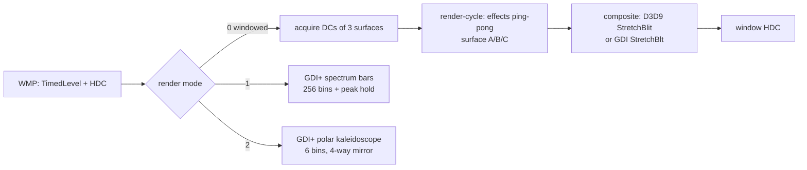

# 2. Alchemy (`mpvis.dll`)

## 2.1 Binary facts

| Property | Value |
|---|---|
| File | `%ProgramFiles%\Windows Media Player\mpvis.dll` (same x64/x86 pair in `Program Files (x86)`) |
| Size | 221,184 bytes (x64) / 174,080 (x86) |
| Build | 2011-08-24 timestamp, `12.0.26100.8115 (WinBuild.160101.0800)` in the shipped Win11 copy; Win7 SP1 ships the 2009 build of the same design (293,376 bytes) |
| CLSID | `{0AA02E8D-F851-4CB0-9F64-BBA9BE7A983D}` "AlchemyVis Class" |
| TypeLib | `{C58F1580-0DF3-401C-93B1-2D9DDA61CF04}` |
| Exports | DllCanUnloadNow, DllGetClassObject, DllMain, DllRegisterServer, DllUnregisterServer |
| Imports of note | d3d9 (delay), gdiplus, gdi32, user32, ole32, oleaut32, advapi32, winmm |
| Static libs | D3DX9 math/utility code is linked in (D3DX warning strings, `DisableD3DXPSGP`) |

The DLL is small because it is a composition engine, not a shader pack: it
draws through GDI, GDI+ and Direct3D 9 surfaces, with DirectDraw calls kept
behind dynamic loading (`ddraw.dll`, `ForceDDraw` registry value).

## 2.2 Object model

`DllGetClassObject` consults a one-entry class table at RVA `0x28000`:

```
{ CLSID*, 0x6350, 0x4250, 0x4050, 0, 0, ... }
```

* `0x180004250` creates a small 0x40-byte object (a class-factory/aggregator
  helper with its own `PTR_FUN_180020460` vtable).
* `0x180004050`/`0x180004064` create the main **0xDF8-byte** visualization
  object. Its primary vtable is `0x1800202D0`; further interface vtables are
  installed at +0x10 (`0x180020230`), +0x18 (`0x1800201F8`) and +0xD0
  (`0x180020158`, the `IWMPEffects2` vtable).

Interface map (Section 1.2): `IToleranceVis`/`IDispatch` at offset 0,
`IWMPEffects`/`IWMPEffects2` at offset 0xD0. Because `Render` is entered
through the `IWMPEffects2` sub-object, its `this` is the object base + 0xC0;
this is why decompiled offsets inside `Render` appear shifted by 0xC0.

Key object fields observed in code. Offsets are relative to the `this`
pointer each method receives (the `IWMPEffects2` interface); some helpers
further subtract `0xC0` to reach the allocation base. Note that a runtime
activation can return a proxy (see `08-runtime-verification.md`), in which
case these fields are not addressable from the caller side.

| Offset | Meaning |
|---|---|
| +0x48 | `IDirect3D9*` |
| +0x58 | non-zero when D3D init succeeded / windowed mode ready |
| +0x80 | render mode selector (0, 1, 2) — see 2.4 |
| +0x144 | alpha byte used by GDI+ gradients |
| +0x148 | 1024-byte peak-hold array (spectrum mode) |
| +0x548 | 1024-byte "previous frame" spectrum array |
| +0x888 / +0x88C | channel count / sample rate from `MediaInfo` |
| +0x890 | title string |
| +0x9B0 / +0x9B8 / +0x9C0 | the three render surfaces |
| +0xCE1 | fullscreen flag |
| +0xD10 / +0xD18 | window DC / HWND |
| +0xDE0 | background colour (32-bit, default from `Tolerance/BackgroundColor`) |

## 2.3 The render pipeline



Three surface objects are created for the window (sizes chosen from the window
area, with thresholds at 30 000 / 0x9C41 / 0x13FD31 pixels²). Each surface
owns a D3D9 render target; the object exposes:

* `+0x88(hdc*)` — acquire a GDI DC for the surface,
* `+0x20(hdc, rect)` — draw/composite the surface to a DC,
* `+0xD0()` — release,
* `+0xA8` — raw 32-bit BGRA pixel pointer,
* `+0x3C` / `+0x40` — width / height in pixels.

The effect objects are double-buffered: every image effect swaps its
`src`/`dst` surface pointers (+0x48 and +0x50) after each pass, and the loop
walks every pixel row with a stride of `width*4`.

## 2.4 Render modes

`Render` (RVA `0x8170`) dispatches on `+0x80`:

| Mode | Routine | What it draws |
|---|---|---|
| 0 | `0x8170` body | windowed path: the D3D effect cycle on three surfaces, then composite to the window DC |
| 1 | `0x8364` | 256 spectrum bars with peak-hold. Reads 5-bin averages of `frequency` and `waveform`, keeps a 256-entry smoothed level array, decays each held peak by 2 per frame, and paints three stacked GDI+ rectangles per bin (glow layers). Bar count is clamped to 256 and scaled to the rect. |
| 2 | `0x8A6C` | Polar rendering: takes 6 samples 10 bytes apart from the level buffer, maps each to an angle and a radius, draws a line from radius r to r+delta around the centre; repeats with horizontal and vertical mirroring, producing 4-way symmetry (kaleidoscope). Uses a GDI+ path gradient brush with a white centre. |

Mode 1 is effectively a classic analyser; mode 2 is the "Alchemy" look. Both
draw directly to the supplied HDC with GDI+ (anti-aliased, smoothing mode 2).

## 2.5 The render cycle and its effects

A "render cycle" (`Untitled Render Cycle` when unset) is a list of effect
instances plus transition entries. The default cycle is built by
`FUN_0x9A94` and looks like this (index → class):

| Index | Class | Profiler id | Notes |
|---|---|---|---|
| 1 | `BlurSwitch` container | 9 | 10 child effects (see below) |
| 2 | `UnnamedRenderEffect` | 7 | 5-tap image filter, ping-pong |
| 3 | `Blur` | 8 | 3-tap (1,2,1)/4 blur |
| 4 | `StrongSuperStar` | 13 | star/particle burst |
| 5 | `ShiftBackgroundBuild` | 12 | scrolling background builder |
| 6 | `StretchBlt` variant | 6 | blit/scale stage |
| 7 | `SoftSmear` | 17 | randomised smear/particles |

The cycle program added by `FUN_0x9E48`, in order
(`effect index, flagA, flagB, timeA, timeB, mode`). The index is 1-based over
the list above (the shipped program uses 7, and the list has 7 entries — the
mapping below is therefore **[inference]** albeit strongly constrained):

```
3, 1, 1, 90,  500, 0
4, 1, 2, 50,  350, 2
6, 0, 1, 30,  500, 1
5, 0, 4, 30,  500, 1
6, 0, 1, 30,  500, 1
4, 1, 3, 50,  350, 2
5, 0, 2, 30,  500, 1
7, 0, 1, 50,  400, 1
```

The cycle object defaults are 1000/5000 ms bounds, rate 1.0, four transition
slots. `mode` selects the transition style (cut/fade/shift family) —
**[inference]**, because the enum names are not present in the binary. The
practical result: Alchemy is a slideshow of procedural effects with 30–90
frame transitions, not a single algorithm.

### Effect classes (verified vtables and entry points)

| Class | Ctor | Vtable | Render entry | Behaviour |
|---|---|---|---|---|
| base `Unnamed Effect` / StretchBlt | `0xAD94` | `0x204C8` | `0xAE40`/`0xAE60` | blit and scale helper; stores name "Unnamed Effect", id 6 |
| `UnnamedRenderEffect` | `0xC004` | `0x20590` | `0xC120` | 5-tap horizontal filter; reads ±1 and ±stride neighbours, writes the other surface, then fills top/bottom rows |
| `Blur` | `0xC058` | `0x20530` | `0xC290` | 3-tap (1,2,1)/4 filter; alternates horizontal/vertical each frame (`+0x54` toggles), mode at +0x50 picks direction |
| `BlurSwitch` | `0xC62C` | `0x205F0` | `0xD8B0` | container that runs 10 layers: 4× composite (`0xDF64`), 2× `0xDE44`, 2× `0xDEDC`, 2× `0xDEA4`; each layer applies a shift/blur pass. The profiler id is 9. |
| `ShiftBackgroundBuild` | `0xF8EC` | `0x20920` | `0xFE50` | builds a scrolling background from the shift parameters |
| `StrongSuperStar` | `0xF960` | `0x208C0` | `0x10120` | star burst. Star size = |screen diagonal| × bass energy (when "scale with audio" is set); rotation mode 0/1/2 selects accelerated / velocity / static accumulation; draws two mirrored star layers |
| `SoftSmear` | `0xFA0C` | `0x20860` | `0x10380` | random-walk smear: updates two angular phases with `rand()` and audio amplitude, then draws with `0xFBC4` at four symmetric positions; the drawn radius follows a sine/beat envelope |
| `StretchBlt` variant | `0x111BC` | `0x20980` | `0x20980+0x38` | scaled blit stage used as cycle index 6 |

The profiler label table (`.data` at `0x282E8`, 24-byte entries
`{wchar_t* name, qword time, qword id}`) names every timed stage:

```
1 Render()              7 UnnamedRenderEffect()  13 StrongSuperStar()
2 RenderFullScreen()    8 Blur()                 14 StrongWonderWave()
3 DDraw Render          9 BlurSwitch()           15 StrongPush()
4 DDraw Flip           10 Shift()                16 StrongPFunc()
5 RenderEffect()       11 ShiftMoveBits()        17 SoftSmear()
6 StretchBlt()         12 ShiftBackgroundBuild() 18 StrongAtomBalls()
```

Only some of these are classes. `StrongWonderWave`, `StrongPush`,
`StrongPFunc` and `StrongAtomBalls` have **no constructor and no literal
timing call site** in this build: ids 14–16 and 18 are present only as legacy
table entries (the effect factory writes ids 6, 7, 8, 9, 12, 13 and 17, and
the render loop uses whatever id the effect object carries). Treat those four
names as historical. The untimed `D3DStretchBlit()` label names the final
composite; `Shift()`/`ShiftMoveBits()` are stages inside the shift container.

### Nested effects created by `BlurSwitch`

`FUN_0x9EB0` allocates a `BlurSwitch` and attaches ten children:

* 4 × `0xDF64` — a composite that itself embeds `0xDEDC` (0.01 default),
  `0xDE44` (0.5/0.5) and `0xDEA4`.
* 2 × `0xDE44` — shift with 0.5/0.5 blend defaults.
* 2 × `0xDEDC` — shift with 0.01/0.1/0.5/0.5/100 defaults.
* 2 × `0xDEA4` — small helper effect.

The exact parameter semantics of these helpers are not named in the binary;
treat them as blur/displacement taps driven by the `Shift*` and `*Mode`
property vocabulary.

## 2.6 Parameter vocabulary

These UTF-16 strings in `.rdata` (0x22600–0x22A70) are the complete parameter
namespace used by the visuals and by preset persistence. Grouping is
**[inference]** from names and from the code that reads them:

* Cycle / transition: `TransitionMode`, `TransitionTime`, `Mode`, `Fade`,
  `RenderMode`.
* Shift family: `XShift`, `YShift`, `Falloff`, `FallPctX`, `FallPctY`,
  `FallDir`, `SinShake`, `SinLoops`, `Rotation`, `MovePct`, `FlowPoint`,
  `PctX`, `PctY`, `Speed`, `Width`, `Vertical`, `ShiftMode`,
  `ReflectionMode`, `LinearMoveX`, `LinearMoveY`, `OceanFactor`.
* Shape/scale: `StretchFactor`, `Scale`, `ScaleMode`, `ScalePct`, `BoxSize`,
  `Divisions`, `Points`, `Max Spin`, `Spin`, `SpinFactor`, `SpinMode`,
  `CenterCircleRadius`, `LittleCircleRadius`, `Wiggly Stretch?`.
* Particle/ball family (AtomBalls): `Ball1 Radius`, `Ball2 Radius`,
  `BassFlex`, `BassJump`, `BounceFrame`, `Hover`, `Mirrored`, `CrossLine`,
  `CrossMode`.
* Misc: `BackgroundColor` (registered property, parsed from a string),
  `Untitled Render Cycle`, `Unnamed Effect`.

`DisplayPropertyPage` is not implemented, so these values are only reachable
through the `IToleranceVis` property bag and through preset files/registry.

## 2.7 `Tolerance` and the DDraw fallback

The install script deletes `HKLM\SOFTWARE\Microsoft\MediaPlayer\Tolerance`.
In the binary the same key is read for `ForceDDraw`; when set, rendering uses
DirectDraw (`ddraw.dll`) instead of D3D9. The `Tolerance` name is Microsoft's
internal image-comparison harness: it also holds the `BackgroundColor`
override read by `SetProperty`.

## 2.8 Embedded bitmaps

Resources `RT_BITMAP` 206–210 are 8bpp RLE images of 64², 128², 256², 512² and
1024². After decoding they are **entirely black** — they are size-specific
cleared surfaces/placeholders, not artwork or palettes. Alchemy's colour comes
from code (GDI+ gradients), not from bitmaps.

## 2.9 Quick summary for a re-implementer

1. Build a small D3D9 (or GDI) compositor with 3 float/RGBA8 targets.
2. Implement a ping-pong image-effect list; each effect gets the TimedLevel
   and may read/write the pair of surfaces.
3. Ship a cycle of {blur, multi-tap displacement, star burst, scrolling
   background, scaled blit, random smear} with timed transitions.
4. Provide the two direct GDI+ modes: 256-bin spectrum with peak hold and the
   6-bin polar kaleidoscope.
5. Expose `IWMPEffects2`; the host supplies audio and never inspects internals.
