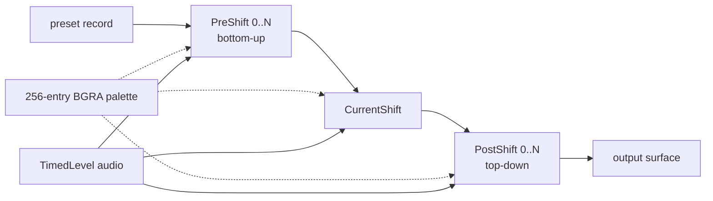

# 4. Battery

Battery is the preset-driven visualizer: a small compositor that layers
"shifts" (procedural drawing/transform operators) over a global palette.
Everything about it is data: WMP ships 25 default presets in the registry and
the engine renders whatever the active preset describes.

## 4.1 Implementation

| Property | Value |
|---|---|
| Class id | `{8D2A317B-D98B-4EFA-89D6-E49F0ACF98A1}` |
| Server | `%SystemRoot%\System32\wmp.dll` |
| Name / description strings | `res://wmploc.dll/RT_STRING/#1563`, `#1564` |
| Factory wrapper | RVA `0x7BA120` (returns `CLASS_E_NOAGGREGATION` for aggregated creation) |
| Object creator | RVA `0x7BD0F4`; allocates **0xFF0** bytes |
| Constructor | RVA `0x7BD1E8` |
| Refcount / status fields | +0xDA0 (object lock), +0xDB8 (frame counter state) |
| Script interfaces | `IBattery` `{F8578BFA-CD8F-4CE1-A684-5B7E85FCA7DC}` (presetCount, preset(i)), `IBatteryPreset` `{40C6BDE7-9C90-49D4-AD20-BEF81A6C5F22}` (title), `IBatteryRandomPreset` `{F85E2D65-207D-48DB-84B1-915E1735DB17}` (title), `IBatterySavedPreset` `{876E7208-0172-4EBB-B08B-2E1D30DFE44C}` (title) |
| Interface map | `0xC3B4A0`: `IWMPEffects` at +0xD90, private interfaces at +0xD80, +0xD88, +0xD98 |

The object is tiny compared with Bars (4 KB vs 178 KB) because it delegates
drawing to a set of shift objects it builds from the preset description. The
constructor creates two COM objects through `CoCreateInstance` before the
first frame (observed as two indirect calls after allocation) — **[inference]**
a surface/renderer pair (DirectDraw/D3D9) rather than visualization logic.

A `BatterySave`/`BatteryPresets.bpx` pair of strings shows the import/export
format: presets can be saved to and loaded from a `.bpx` file; the same data
is also written to the registry (below).

## 4.2 Preset storage model

Default presets are installed into

```
HKCU\Software\Microsoft\MediaPlayer\Battery\Presets\<preset name>
```

and the shipped values come from `wmp.dll` resource `REGISTRY #10160`. Each
preset is a small record:

| Value | Type | Meaning |
|---|---|---|
| `Title` | SZ | `res://wmploc/RT_STRING/#57xx`, e.g. `#5700` = "brightsphere" |
| `PreShiftCount` | DWORD | number of layers applied before the current shift |
| `PreShift0..N` | SZ | shift class names, bottom-up |
| `CurrentShift` | SZ | the main shift class |
| `PostShiftCount` | DWORD | layers applied after the main shift |
| `PostShift0..N` | SZ | shift class names, top-down |
| `PaletteLocked` | DWORD | 1 = keep the preset's palette (no hue cycling) |
| `Palette` | BINARY | 1024 bytes = **256 × BGRA** entries |
| `CurrentShiftInfo\i\dbl1..8` | SZ (float text) | parameter vector for the i-th current shift |
| `PreShiftInfo\i\dbl1..8` | SZ | parameters for the i-th pre-shift |
| `PostShiftInfo\i\dbl1..8` | SZ | parameters for the i-th post-shift |

`i` is the layer index; each shift receives exactly eight doubles. Unused
slots are written as `0`. Numbers are serialized with `%g`-style precision
(e.g. `-0.037548448704905`, `384.000015258789`), which is why some integers
look noisy.

## 4.3 Shift classes

Shift names seen in the binary and in preset data:

```
CDotPlane          CEdgeFalloffShift  CJiggyScribble    CLinearShift
CRingSpinShift     CShiitake          CSinShimmerShift  CStarburstShift
CStretchShift      CSwirlShift        CThingusShift     CTileShift
CTrigShift         CTrigStretchShift  CZoomShift        CTwirlocity
CEdgeTrace         CEdgeGradiant      CCosEdgeGradiant  CSpectrumEdge
CWaveEdge          CCircleWaveform    CJDar
```

Behaviour inferred from names + parameter vectors:

| Family | Classes | Observed parameter pattern |
|---|---|---|
| Plane/pattern generators | `CDotPlane`, `CTileShift`, `CTileShift` | `dbl1` = count/seed (integers like 30–214), `dbl2` = 0–6 mode, `dbl4` = 384 (grid/period), occasionally `dbl5` = 0.7–1.2 strength |
| Edge/waveform traces | `CEdgeTrace`, `CSpectrumEdge`, `CWaveEdge`, `CCircleWaveform`, `CEdgeGradiant`, `CCosEdgeGradiant` | integer counts (e.g. 55, 159), small mode ints (0/1/2/3), fractional phase/rounding factors |
| Motion shifts | `CLinearShift`, `CStretchShift`, `CSwirlShift`, `CRingSpinShift`, `CTwirlocity`, `CZoomShift`, `CStarburstShift`, `CShiitake` | signed speed values (often ±0.03), amplitudes 0.1–7, occasionally large integers (32, 30) as segment counts |
| Ink/scribble | `CJiggyScribble`, `CJDar`, `CThingusShift` | integer seeds/points (30–94), 0/1 flags, percentage fields (100) |

`CJDar` and `CJiggyScribble` appear most often (10 and 6 uses) and are the
generic "ink" post/pre layers. `CSwirlShift` + `CDotPlane` is the common
"tornado/smoke" combination.

Every shift gets the same 8-slot vector, so a generic implementation can:

1. parse the eight doubles,
2. dispatch on the class name,
3. treat unknown slot positions as defaults.

That is sufficient to play back any preset without knowing each class's exact
parameter semantics.

## 4.4 Palettes

`Palette` is a 256-entry table of 4-byte BGRA (little-endian bytes are
`B,G,R,A`; alpha is 0 in all inspected presets and is treated as opaque).
Examples:

* `BrightSphere` has no `Palette` value → palette generated at runtime from
  the background/foreground colours.
* `circledance` palette starts `07121900 07121A00 08121C00 …` — a blue-cyan
  ramp with tiny steps, i.e. a smooth gradient across the 256 entries.
* `Geeks Kick ASCII` starts `E7E3E900 E6E3E900 …` — a warm grey ramp,
  descending.
* Several presets share an identical palette (`ISeeTheTruth` and `Nerds Are
  Cool` start `16110300 …`), which is why they look like colour variants.

`PaletteLocked=1` means the palette is used as-is. When 0, WMP rotates/hue-
shifts the palette over time (the script surface exposes `hueShift`,
`backHueShift`, `buttonHueShift`, `exclusiveHueShift`, `backgroundImageHueShift`).

## 4.5 Default preset set

25 presets ship in `#10160` (title string ids 5700–5724):

| Registry name | Title string |
|---|---|
| `BrightSphere` | #5700 brightsphere |
| `cominatya` | #5701 |
| `dandelionaid` | #5702 |
| `DrowningFlower` | #5703 |
| `EletriArnation` | #5704 |
| `cottonstar` | #5705 |
| `gemstone matrix` | #5706 |
| `GrooveSwirl` | #5707 |
| `eventhorizon` | #5708 |
| `illuminator` | #5709 |
| `ISeeTheTruth` | #5710 |
| `kaleidoscope` | #5711 |
| `Nerds Are Cool` | #5712 |
| `Lotus` | #5713 |
| `relativelycalm` | #5714 |
| `sleepyspray` | #5715 |
| `Smoke or Water` | #5716 |
| `what is an egab` | #5717 |
| `SpidersLastMoment` | #5718 |
| `strawberryaid` | #5719 |
| `the world` | #5720 |
| `circledance` | #5721 |
| `tornado` | #5722 |
| `Geeks Kick ASCII` | #5723 |
| `khemicalnova` | #5724 |

Each entry is a complete visual definition; "Battery" itself has no hard-coded
art. The UI description is "This collection includes a random setting that
always shows a unique visualization" (`#1564`) — the random mode picks a
preset (and shuffles palette/hue) on each activation.

## 4.6 Preset pipeline



`CurrentShiftInfo[i]` parameter vectors are indexed by layer; the same class
can appear twice with different vectors (see `khemicalnova`: two `CJDar`
post layers with different parameters).

## 4.7 Reimplementation checklist

* Data model: preset = ordered lists of (class name, 8 doubles) + palette.
* Registry/file I/O: match the value names and 1024-byte palette exactly so
  existing `.bpx`/registry presets load unchanged.
* 256-colour indexed output is the natural target; the original writes into
  the same 32-bit surfaces as the other visualizations, with palette lookups.
* Provide at least: a plane/pattern generator, edge/spectrum tracer, swirl /
  stretch / ring / tile / starburst motions, and a generic ink layer. That
  covers all 25 presets.
